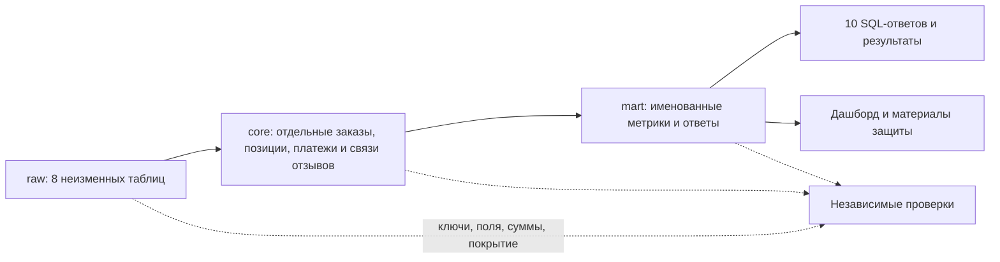

# Capibara перед реализацией

Repository: `kiruha355/rwb_hak`. Input main: `1939068295d7203a15cbb0a1ab5d407caca90f58`.
Research input: `72c1fb6ffe43e95b2ba539dc1b396374f4bfde3a` ветки `kiruha355/idea-bank`.
Сверка начата 2026-10-28 09:01 UTC. Автор: W-06, Codex / Sol.

Основное направление принято по текущему прямому уточнению пользователя. Это не означает 17 отдельных человеческих approvals. Ниже различаются **правило пользователя**, **рабочий выбор агента**, **параметр для выбора** и **внешнее уточнение**. Последнее поручение разрешает реализацию независимых частей четырьмя Sol xhigh Fast, отдельное ведение сдаваемых материалов и ревью Astra high без Fast. Этот бриф объясняет решения; канонический журнал остаётся [decision-log.md](https://github.com/kiruha355/rwb_hak/blob/72c1fb6ffe43e95b2ba539dc1b396374f4bfde3a/docs/decision-log.md).

## Что готово

| Часть | Фактическое состояние |
|---|---|
| Синтез идей v2 | Опубликован в main `1939068`: конкретные таблицы, 32 рекомендации C1–C32, план и 17 вопросов. Статус документа на момент публикации — предложение. |
| Контекст автора синтеза | Прочитаны idea/00–10, explainer, журнал решений, контракт, стенограмма и семь corpus-пакетов. Утверждение «explainer не видел» не подтверждается. |
| Поздний ресерч | Финальный отчёт, shortlist 18 findings и backlog опубликованы позже, на `72c1fb6`. Их локальные байты сверены с этим ref. 102 записи — исходный пул, не 102 подтверждённых факта. |
| Данные и числа | Есть независимые CSV/Decimal проверки и сообщённые автором синтеза SELECT к raw. Это разные методы. Проверенной модели core/mart в этих материалах ещё нет. |
| Исполняемый результат | На сверенных main и idea-bank нет файлов model/ и answers/. Разработка теперь разрешена для независимых частей; будущие результаты оцениваются отдельно. |
| Локальное окружение | [Dev runbook](https://github.com/kiruha355/rwb_hak/blob/90e45804d1913ff00a7b3937cf13de247dd3c8b4/docs/dev-environment-20261028.md): offline-проверки прошли; Docker/живая БД заблокированы ресурсным guard. Это не запрет писать SQL и документацию. |

После этого снимка четыре воркера передали локальную реализацию на review: core содержит 7 справочников и 4 факта. Дополнительный `dim_customer_context` сохраняет все исходные customer_id и контекст адреса; это уточнение рабочего проекта агента, не потеря отдельности покупателя. Сборка, marts/ответы и набор 201 invariant checks написаны. Родитель независимо повторил 14 Python tests и 93 проверки маленькой DuckDB fixture, static-проверку 19 файлов и план 16 SQL-сценариев: успех относится к этим методам. Исполнение в PostgreSQL, настоящие ответы из core, raw-binding и rollback остаются pending.

Финальный ресерч усиливает требования: негативные проверки, rollback, повторная сборка и manifest должны пройти до объявления готовности. В синтезе часть из них отнесена в P1/P2; порядок написания не отменяет приёмку. Обе архитектуры detail-core и constellation допустимы; одинаковые цифры не выбирают между ними. Совпадение контроля помогает выбрать рабочую формулу, но не заменяет согласование смысла метрики.

## Рабочий курс и границы исполнения

**Прямые правила пользователя/задания:** raw сохраняется; ответы идут из модели; код пишут агенты, команда должна его понимать; полный замысел не урезается до демо; неизвестное не превращается в ноль; решения имеют причины и альтернативы. Текущая авторизация запускает реализацию, не закрывая смысловые вопросы молчанием.

**Рабочие выборы агента для обратимой реализации:** SQL/PostgreSQL 16; детальные таблицы с общими справочниками как рабочая форма; исходные натуральные ключи; покупатель по customer_unique_id, адрес на заказе; review-order пары сохраняются целиком; независимая агрегация children до соединения; деньги numeric с проверкой до округления; build/check/control раздельны; спорные показатели выпускаются под разными именами. Представление отзывов и форма core остаются явно заменяемыми до утверждения конкретного варианта. Это implementation defaults, а не приписанные человеку решения.

**Не отдавать как решённое:** одна трактовка counts Q1/Q2; единственный вес отзывов; определение календарного опоздания и дедлайна отгрузки; выбранная область и технология дашборда; универсальная граница PostgreSQL; сроки и критерии организаторов. Агенты могут реализовать именованные варианты, подготовить интерфейс/документацию и продолжать независимую часть.

Контракт для исполнителей: `core.dim_date`, `dim_order_status`, `dim_customer`, `dim_seller`, `dim_category`, `dim_product`; `fact_order`, `fact_order_item`, `fact_payment`, `fact_review`. Grain и исходные ключи — по §7.1 синтеза. Сначала сохраняем исходную детализацию; производные метрики живут в mart. Если для совместимости нужна колонка из §7.1, она должна быть выведена явно из независимых агрегатов, с описанными NULL/coverage. Не добавлять спорную бизнес-логику молча. Платёжное покрытие включает **both/items_only/payments_only/neither** и отдельно полноту price/freight/payment.

## Все 17 вопросов

Нумерация точно повторяет §9 синтеза. Рекомендация ниже — готовый вариант для выбора; actor не подменяется статусом исходного документа.

Место принятия — текущий тред «Идеи, решения и план реализации». Explainer объясняет и отражает итог; отдельного переноса обсуждения не требуется. Пока пользователь не ответил на пакет, рекомендации не становятся отдельными человеческими approvals.

Предлагаемый пакет конкретизирует прежние варианты: в п.7 основное опоздание сравнивается по календарным датам, timestamp-вариант остаётся отдельно; в п.9 границы shipping_limit по min/max получают отдельные названия; в п.10 рекомендуем Streamlit после mart, без установки до разрешённого состояния ресурсов; в п.17 порог пометки малой выборки 30, стартовая сила сглаживания k=30, raw mean и n всегда видимы. Число 30 — инженерный параметр показа, не статистическая гарантия. Для сравнений продавцов рабочий вес — одна средняя оценка на заказ, содержащий продавца: такой срез пересекается между продавцами и не складывается в общий итог.

### 1. Как устроить core

**Смысл.** Храним события раздельно, а описания товаров, покупателей и статусов — в справочниках. Одна строка позиции не должна превращаться в несколько строк из-за двух платежей и трёх отзывов.

**Варианты.** A: нормализованный детальный core, близкий к источнику, плюс аналитические views. B: созвездие из четырёх фактов и шести общих справочников. Оба могут сохранить все данные. Единый плоский join размножает суммы; только готовые агрегаты теряют детали для новых вопросов.

**Рабочий выбор агента:** B, обратимо, с сохранением grain всех источников. Причина — явные факты/измерения и уже разработанный контракт таблиц, а не превосходство в точности. Цена — больше связей и обязанность проверять согласованность агрегатов.

**Проверка:** mapping каждого бизнес-поля raw→core, ключи и связи в обе стороны, новый запрос к платежам/отзывам. Доказательства: C13; research S02/S03. Параметр для человека — окончательная форма core; независимую сохранность и SQL-каркас можно делать сейчас.

### 2. Что считать числом заказов в Q1

**Смысл.** Заказ оформили и заказ доставили — разные события. Выручка delivered не превращает автоматически соседний count в delivered-count.

**Варианты:** все оформленные заказы в окне сентября 2016 — августа 2018: **99 421**; delivered в том же окне: **96 478**. Это суммы по 24 календарным месяцам, включая пустой ноябрь 2016. Во всём снимке заказов 99 441 — не путать с оконным числом.

**Рекомендация:** сохранить обе колонки `orders_placed` и `orders_delivered`, выручку показать отдельно. Это не требует выбирать за организатора. Цена — лишняя, но осмысленная колонка; если жюри требует одну, основной count нужно уточнить.

**Проверка:** календарь без дыр; сумма месячных counts равна соответствующей популяции; отмены не дают выручку. Основание C17/F28, S12. Внешнее уточнение — какая колонка требуется в ответе.

### 3. Что считать у продавца в Q2

**Смысл.** Продавец имеет только свои позиции; один заказ может содержать нескольких продавцов. Counts продавцов нельзя безусловно складывать в общий count заказов.

**Варианты:** у топ-продавца **1 124 delivered-заказа и 1 148 delivered-единиц**; все статусы дают **1 132 заказа и 1 156 единиц**. Выручка **226 987.93** относится к delivered-позициям, без доставки.

**Рекомендация:** delivered counts рядом с delivered-выручкой; all-status counts отдельными именованными колонками. Рейтинг по выручке на текущем снимке от этого не меняется. Цена — необходимость объяснить разные совокупности.

**Проверка:** distinct order_id внутри seller, число его item rows, сумма только его price; оба набора воспроизводятся. Основание C17/F29, S12. Основную трактовку задания уточняем внешне, детализация уже пригодна к реализации.

### 4. Чек и строки заказа в Q3

**Смысл.** Сначала складываем позиции одного заказа с доставкой, затем усредняем заказы. Усреднение цен item rows отвечает на другой вопрос.

**Варианты денег:** item+freight по delivered даёт **159.88** на **96 478 заказах**; payments — **159.86** на **96 477 заказах с платежами**. Это разные компоненты и знаменатели. Рабочая рекомендация — первое как `order_gmv`, payments отдельно; контроль поддерживает этот выбор.

**Варианты строк:** две одинаковые единицы одного товара от одного продавца — 2 исходные строки, 2 единицы, но 1 группа товар×продавец. Средние: `avg_source_rows=1.142`, `avg_units=1.142`, `avg_distinct_lines=1.039`. Числа округлены для показа.

**Проверка:** все три имени в результате; не называть 1.039 исходными строками. В §5.3 A4 синтеза осталась такая ошибка, хотя C32 её исправляет. Основание C15/C32/F26/F46, S12. Это рабочие варианты, окончательная семантика должна быть видна в паспорте.

### 5. Какие периоды применять к Q2–Q5

**Смысл.** Окно явно задано для Q1; перенос его на остальные вопросы меняет популяцию даже при похожих итогах.

**Варианты:** общее окно Q1 для всех либо весь снимок для Q2–Q5. Delivered вне окна Q1 отсутствуют: Q2/Q3/Q5 сейчас совпадут. Для Q4 весь снимок даёт **96 096 покупателей, 2 997 повторных, 3.12%**; окно Q1 — **96 090, 2 987, 3.11%**.

**Рекомендация:** Q1 — заданное окно; остальные — весь снимок, с явным `window` в паспорте. Контроль Q4 поддерживает это, но совпадение не заменяет правило задания.

**Проверка:** границы даты и статусы в каждом SQL, сравнительный расчёт обоих окон. Основание C16/F27, S12/S13. Независимые views можно реализовать сейчас; интерпретацию периода зафиксировать перед финальной сдачей.

### 6. Как хранить отзывы

**Смысл.** Один review_id может быть связан с несколькими заказами: 99 224 уникальные пары против 98 410 review IDs. Удаление дублей ID потеряет связи.

**Варианты:** факт пары с payload в каждой строке либо сущность review и мост review_order. На снимке все пять payload-полей повторяемого ID совпадают; оба варианта сохраняют данные. Bridge с версионированием способен обработать будущий конфликт — он не является заведомо неверной схемой.

**Рабочий выбор агента:** сохранять пары; отдельную сущность/view выводить при подтверждённом совпадении payload. При конфликте view обязан показать конфликт/варианты, а не произвольно выдать один «правильный» текст. Цена пары — повтор payload.

**Проверка:** round-trip всех связей и значений, NULL-aware сравнение, искусственный конфликт. Средняя по парам, отзывам и заказам — три разных веса; последний отзыв не доказанное «актуальное мнение». Основание C14/C8/F33, S06. Вес дашборда остаётся параметром.

### 7. Что делать с аномалиями дат

**Смысл.** Передача в доставку раньше покупки портит соответствующий интервал, но не обязательно портит цену или дату фактического вручения.

**Варианты:** удалить весь заказ; исправить дату догадкой; исключить из всех длительностей; сохранить исходное и проверять пригодность для конкретной метрики.

**Рекомендация:** последняя политика. Флаги по типам аномалий, журнал причин, никаких придуманных дат. Отсутствующая дата остаётся неизвестной. `is_late` требует отдельно согласованного day/timestamp comparison, а `is_handover_late` — правила сведения нескольких shipping_limit_date заказа.

**Проверка:** случаи отрицательного интервала, NULL, дата у canceled; исключение только из затронутой пары дат. Основание C19/F35, S08/S13. Флаги и сохранность реализуем сейчас; точные правила поздней доставки подписываем как варианты.

### 8. Для кого и о чём дашборд

**Смысл.** Экран должен помогать человеку решить, что делать: развивать продажи, разбирать доставку или исправлять данные.

**Варианты:** коммерция (категории, продавцы, чек); логистика/сервис (обещание, задержки, оценки); качество (покрытие и аномалии). Коммерция проще опирается на Q1–Q5; логистика даёт отдельный сюжет, но сильнее зависит от дат и зрелости наблюдений.

**Рекомендация:** выполнение и сервис, с краткой шапкой продаж и переходом к качеству. Сюжет «цена опоздания» означает связь задержек и оценок, не доказанный причинный эффект или денежный ущерб. Корзин, выкупа, возвратов и комиссий в восьми CSV нет.

**Проверка:** для каждого экрана пользователь→вопрос→метрика→источник→действие; показываем знаменатель, coverage, незрелые данные. Основание C25/D17, S13–S15. Область — человеческий выбор; паспорта и варианты концепции готовятся независимо.

### 9. Как говорить о причинах опозданий

**Смысл.** Последовательность дат показывает этап, но не виновника. Дата передачи хранится на заказе, срок продавца — у позиции.

**Варианты:** «виноват перевозчик»; «виноват продавец»; описать наблюдаемый этап и ограничения сравнения.

**Рекомендация:** третье. Число из синтеза: примерно у 72% опоздавших заказов передача укладывается в использованный срок; это характеристика выбранного правила, не расследование причин. Даже фраза «задержка после передачи» не доказывает вину конкретной стороны.

**Проверка:** описать сведения item deadlines к заказу; показать альтернативы min/max и coverage, не переносить общий timestamp на независимые отгрузки. Основание C18/F36, S13. Отказ от причинного обвинения не требует нового решения; конкретный deadline остаётся параметром метрики.

### 10. Нужен ли работающий прототип

**Смысл.** Письменное задание требует концепцию; прототип помогает показать результат и обсуждать его, но не заменяет модель и ответы.

**Варианты:** только концепция; статический HTML с фактическим экспортом; Streamlit; BI-сервис. HTML проще раздать; Streamlit удобен для фильтров и запросов; BI добавляет окружение и настройку.

**Рекомендация:** подготовить концепцию и общий контракт метрик сейчас; работающий прототип — после проверенных mart/ответов. Streamlit — кандидат, а не уже утверждённая зависимость. Ресурсный guard Mac делает запрет тяжёлого запуска реальным ограничением.

**Проверка:** цифры прототипа равны SQL при одинаковых фильтрах; пустое/неполное не превращается в ноль. Основание C27, S15. Сдаваемый агент готовит структуру и варианты; выбор инструмента не должен блокировать SQL.

### 11. Кто владеет моделью и SQL

**Смысл.** Нужен ответственный за совместимость файлов и интеграцию, а не только список авторов исследований.

**Варианты:** один универсальный исполнитель; несколько исполнителей без границ; разделение core, build, marts/answers и checks при одном интеграторе. Синтез предлагал людей kontar/mput/kiruha355 — это рекомендация, не назначение этих людей.

**Текущее прямое поручение пользователя:** до четырёх GPT-6.1-Sol xhigh Fast на реализацию, отдельный агент на сдаваемый комплект; Astra high без Fast на ревью. Рабочий выбор агента — четыре непересекающихся зоны и единый контракт имён; W-01 сохраняет роль публикации общего checkout.

**Проверка:** ownership перед записью, единый DDL/mart/check contract, адресные handoff и SHA. Ревью не останавливает независимую работу; замечания к зависимому коду исправляются до приёмки. Людям не назначаются обязанности без основания.

### 12. Где канон решений и правил

**Смысл.** Повтор одного решения в разных файлах без ссылок быстро создаёт противоречия.

**Варианты:** каждый документ ведёт свою истину; один огромный файл; отдельные реестры с чёткими ролями и ссылками.

**Рекомендация:** сохранить уже установленный канон: decision-log — решения/источники полномочий; workstreams — ownership/статус; ideas — индекс идей; research/README — исследования; explainer и этот бриф объясняют и ссылаются. Не замораживать чужой реестр самовольно. CLAUDE.md может импортировать AGENTS; это совместимость, не запуск Claude.

**Проверка:** каждый факт имеет ref/метод, каждое решение — actor и основание; accepted не означает implemented. Основание U-02–U-04, C24/C29. Редактура принадлежит writers; worker передаёт handoff, а не перетирает общий файл.

### 13. Оценка 150 или 155, нужна ли презентация

**Смысл.** PDF даёт 155 баллов и семь критериев; стенограмма говорит о 150 и отдельно о качестве презентации. Сами источники расходятся.

**Варианты:** выбрать один источник без объяснения; дождаться уточнения и остановиться; покрыть письменные критерии и подготовить показ/репетицию, вынеся расхождение на уточнение.

**Рекомендация:** третье. Отдельный агент ведёт сдаваемые материалы и структуру презентации; число слайдов и инструмент — технический выбор. В презентации показываем реальные результаты, отсутствие runtime доказательства не скрываем.

**Проверка:** каждый из семи письменных критериев связан с артефактом и проверкой; команда может объяснить ключ, JOIN, метрику и контрпример. Основание C26/P7/P8, S18. Действующий регламент уточняют организаторы; это не блокирует подготовку.

### 14. Что делать с числом 123.75

**Смысл.** Контрольная цифра может быть ошибкой или использовать неизвестную трактовку. Подбирать определение ради совпадения нельзя.

**Наблюдение:** delivered avg(price) по исходным item rows — **119.98**; avg(price+freight) по item rows — **139.97**; order-level чек — **159.88**. Число 123.75 автор синтеза не воспроизвёл восемью проверенными способами; аудит CSV также не подтвердил предложенную трактовку.

**Рекомендация:** отдать корректные именованные расчёты и сохранить вопрос организаторам. Не утверждать, что 123.75 — доказанная «ошибка уровня позиции» или что её происхождение известно.

**Проверка:** SQL, компоненты и знаменатели опубликованы вместе с результатом; raw/CSV baseline отделён от результата core. Основание F37 и независимый data-audit. Отсутствие совпадения не разрешает менять исходные данные.

### 15. Какой допуск в сверке платежей

**Смысл.** Разница в одну сотую может учитываться или нет — это правило отчёта, а не повод исправлять цену или payment.

**Варианты на 98 665 заказах с обеими сторонами:** exact delta≠0 — **639**, сумма **−1 819.51**; abs(delta)>0.01 — **366**, сумма **−1 818.84**. Число 366 с суммой −1 819.51 смешивает две разные выборки.

**Рекомендация:** считать оба порога, signed и absolute delta, сохраняя обе исходные суммы. Сначала coverage: both/items_only/payments_only/neither и полнота компонентов. Неизвестная доставка не становится нулём; измеренный ноль сохраняется.

**Проверка:** сумма и count используют один предикат; тесты delta=0.01, NULL-компонент и отсутствующая сторона. Основание U-07/C20/F30, S04/S08. Выбор основного tolerance — параметр для текста отчёта; обе ветки реализуются независимо.

### 16. Что делать с четырёхзначными индексами

**Смысл.** Индекс — идентификатор, не величина для арифметики. Добавленный ведущий ноль — наше преобразование, не наблюдённый факт.

**Варианты:** заменить исходник дополненным; оставить только исходник; хранить исходный текст и отдельную производную нормализацию.

**Рабочий выбор агента:** третий. `zip_prefix_raw` сохраняется; `zip_prefix` дополняется до пяти знаков только для допустимого формата. Нецифровое и слишком длинное не обрезается автоматически. Цена — дополнительная колонка и явный mapping.

**Проверка:** raw round-trip; примеры 1234→01234, уже пятизначный, NULL и неожиданный формат. Основание C28, S05/S08. Это обратимая техническая подготовка; разных адресов недостаточно для вывода о переезде.

### 17. Как сравнивать оценки при малой выборке

**Смысл.** Один отзыв на 5 и тысяча отзывов со средним 4.8 не дают одинаковую уверенность в качестве продавца.

**Варианты:** сырая средняя; скрыть группы ниже порога; сглаживать к общей средней и показывать объём. Пример формулы: `(n*mean + k*global_mean)/(n+k)` — это модельная оценка, не фактическая средняя.

**Рекомендация:** всегда хранить raw mean и n; порог 30 и коэффициент k оставить явными параметрами, показывать рядом сглаженную оценку с названием. 30 не является доказанным статистическим стандартом; порог достаточности и сила сглаживания — разные настройки.

**Проверка:** n=0/1/29/30, NULL, k=0; выбранный вес отзывов и пересечение seller-заказов описаны. Основание §9.17/D7, S06/S14. До выбора параметров можно сделать raw-метрики, coverage и функцию с аргументами; нельзя выдавать неподписанный рейтинг за окончательный.

## Как оценивать развилки по семи критериям

Для принципиальных альтернатив core, pair/bridge, counts, аномалий, области и атомарности действует опубликованная матрица §6.3 синтеза. Это оценка пользы/рисков/доказательства, не обещание заработанных баллов. Дополнение для всего пакета:

| Критерий | Что меняется от выбора | Риск и доказательство |
|---|---|---|
| Ответы, 30 | Counts/окна/компоненты Q1–Q5 влияют на цифры; форма корректного core и индекс не должны менять их. | Неподписанная популяция; сравнить оба варианта из core, полный календарь и знаменатели. |
| Модель, 30 | Раздельные grains, buyer identity, review associations, missing categories и NULL. A/B и pair/bridge допустимы при сохранности. | Потери/дубли; mapping, ключи, суммы и негативные примеры. |
| Поддерживаемость, 15 | Manifest, атомарность, повторяемость, единые контракты и ownership. Выбор коммерции или сервиса напрямую не улучшает сборку. | Изменённый вход/частичная модель; rollback и повторная сборка на одном manifest. |
| Понимание и вброс, 25 | Чёткие определения, причины выбора и изменяемые правила. | Совпадение контроля принято за смысл; участник объясняет контрпример и новый вопрос. |
| Дашборд, 20 | Область, веса/coverage/периоды, действия пользователя. SQL-транзакция непосредственно не выбирает полезный экран. | Средние и distinct сложены по срезам; пересчёт numerator/denominator, сравнение UI с SQL. |
| Использование ИИ, 15 | Источник→предложение→проверка→actor решения для любого варианта. Название модели core само по себе баллов не доказывает. | Выдуманный PASS/approval; журнал источников и воспроизводимые проверки, сохранённые возражения. |
| Рост, 20 | Новые события, история при наличии источника, нагрузочные триггеры и откат. Выбор count Q1 напрямую не определяет стек. | Выдуманный предел строк или история из снимка; одинаковые workloads/SLA, full-vs-incremental и паритет. |

## Очерёдность и приёмка

1. **Независимо сейчас:** detail core, manifest, транзакционный каркас, отдельные children, именованные варианты метрик и проверки, черновики сдаваемых материалов.
2. **Совместимость:** согласовать DDL/mart/check contract; статические и лёгкие offline проверки. Нельзя выдавать их за SQL execution.
3. **После разблокировки стенда:** сборка с нуля, повтор, rollback на ошибке, ключи/поля/суммы/coverage raw↔core, негативные примеры, Q1–Q5 из модели.
4. **После конкретизации параметров:** окончательные паспорта, UI/рейтинги/прототип, Q6–Q10 после публикации задания, фактические цифры и защита.
5. **Ревью Astra high, обычный service tier:** цельный пакет с файлами и evidence; независимые потоки продолжаются, замечания к принимаемому результату закрываются до его приёмки.

`REPEATABLE READ` не доказывает безопасность при параллельном TRUNCATE raw: нужен документированный и проверенный протокол загрузки. `CASCADE` допустим только в принадлежащих команде схемах после проверки внешних зависимостей. `check_results` внутри упавшей транзакции откатится — текст ошибки/отдельный check должны сохранять диагностику. Эти условия не отменяются красивым demo.

## Источники

- [Синтез v2 на точном main ref](https://github.com/kiruha355/rwb_hak/blob/1939068295d7203a15cbb0a1ab5d407caca90f58/docs/idea-synthesis.md): §0, §6–§9.
- [Финальный research](https://github.com/kiruha355/rwb_hak/blob/72c1fb6ffe43e95b2ba539dc1b396374f4bfde3a/research/internet-2026-10-28/final-report.md), [18 findings](https://github.com/kiruha355/rwb_hak/blob/72c1fb6ffe43e95b2ba539dc1b396374f4bfde3a/research/internet-2026-10-28/synthesis/selected-findings.md), [backlog](https://github.com/kiruha355/rwb_hak/blob/72c1fb6ffe43e95b2ba539dc1b396374f4bfde3a/research/internet-2026-10-28/backlog.md).
- CSV-аудит `research/data-audit-2026-10-28/findings.md`: независимый локальный baseline, не DB/core PASS. Его публикация не приписывается main; опубликованное evidence доступно через final-report выше.
- [Задание](../hack-context/hackathon-students/docs/tasks.md), [handout](../hack-context/hackathon-students/docs/handout.md), [ownership](workstreams.md), [канон решений](https://github.com/kiruha355/rwb_hak/blob/72c1fb6ffe43e95b2ba539dc1b396374f4bfde3a/docs/decision-log.md), [explainer](https://github.com/kiruha355/rwb_hak/blob/72c1fb6ffe43e95b2ba539dc1b396374f4bfde3a/explainer.html).

SHA256 сверенных published research: final-report `04cb6278ca4942c348c5ec162183de64c7645b4e91d84d96ca729e27d4f6aa8f`; selected-findings `4ae6d0ea2a2b48a459dda79317edc241f46222016dce3fec36a45c98111d847f`; backlog `033911af3e144409d8b87041ce27d142674369eb37b0e04b175cfb5102e11666`.
